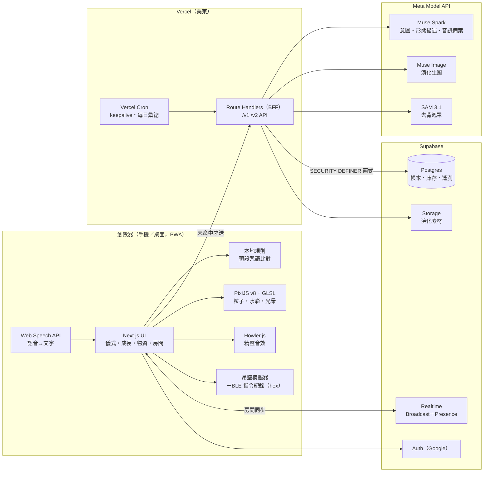
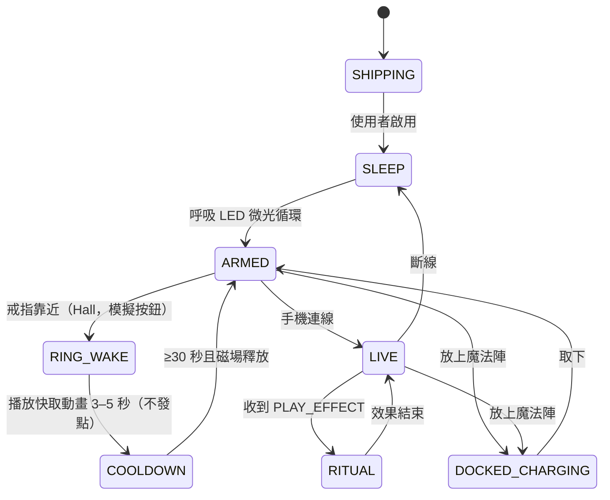

# Spirit Companion — Tech Stack 與系統設計

浩信科技 | 比賽版 H0 | 2026-10-29 | 對應文件：`docs/PRD.md`（功能編號 F-xx 見 PRD）

> 本文件是 Meta Global AI Developer Hackathon（Startup 賽道）比賽版的技術決策。所有標「待驗證」的項目，開工第一天（M1）必須以帳號實際權限核對，不得以猜測值上線。

---

## 1. 決策摘要

### 1.1 方案比較結論

| 方案 | 組成 | 結論 |
|---|---|---|
| **A（採用）** | Next.js＋Supabase＋Vercel | 帳本／庫存需要 Postgres 交易與 row lock；Google 登入、Realtime、Storage 內建；agent 範例最多，6 天內風險最低 |
| B | React＋Cloudflare Workers／D1／Durable Objects | Durable Objects 做房間最好，但 D1 只有 batch、無 row lock，帳本一致性要自補；Google OAuth 要自做 |
| C | Next.js＋Firebase | Auth、即時都好，但 Firestore 非關聯式，帳本對帳與量化後台查詢不自然 |

### 1.2 各層選型

| 層 | 選型 | 理由 | 替代方案 | 為何不選 |
|---|---|---|---|---|
| 框架 | Next.js 15（App Router）＋TypeScript strict | Route Handlers 當 BFF，Meta 金鑰只在伺服器；SSR 首頁利於分享 | Vite SPA | 需另架 API 服務 |
| 部署 | Vercel（美東 iad1） | 歐美優先；Cron、預覽部署、地理 header 內建 | Cloudflare Pages | 與 Supabase 整合範例少 |
| 資料庫 | Supabase Postgres | 交易、row lock、SECURITY DEFINER 函式、RLS | D1／Firestore | 見 1.1 |
| 登入 | Supabase Auth（Google OAuth） | 一律 Google 登入（PRD 已定），可量化來源與留存 | NextAuth | 多一層 session 同步 |
| 即時 | Supabase Realtime（Broadcast＋Presence） | 2–4 人房間；免費版 200 同時連線足夠 | Vercel 上自架 WebSocket | Vercel Functions 不支援長連線 |
| 物件儲存 | Supabase Storage | 演化素材（512px PNG、吊墜 sprite） | Vercel Blob | 權限要另外接 |
| AI | Meta Model API（OpenAI 相容格式） | 意圖、演化、去背全用 Meta 工具，對應評分「Meta AI tooling」 | — | 比賽及格門檻要求 |
| 繪圖 | PixiJS v8（WebGL，失敗退 Canvas）＋自寫 GLSL filter | 1,200 粒子 60 FPS；2.5D 水彩＋光暈 | three.js | 手機 3D 體積光 6 天內難調穩 |
| 語音 | Web Speech API（主）；Muse Spark 音訊輸入（備案） | 免費、不耗 Meta 額度 | 自架 Whisper | 要另付算力、違反「不額外花費」 |
| 音效 | Howler.js | 精靈哼唧聲、笑聲；行動裝置解鎖處理成熟 | Web Audio 直寫 | 重複造輪 |
| 多語系 | next-intl（en 先上；zh-Hant、ja 預留） | App Router 原生支援 | i18next | 設定較多 |
| 驗證 | Zod | API 輸入、AI JSON 輸出共用 schema | — | — |
| 測試 | Vitest＋Playwright | 經濟函式並行測試＋手機尺寸主流程 | Jest／Cypress | 較慢 |
| 樣式 | Tailwind CSS＋CSS variables（design tokens） | 快速重繪美術風格 | CSS Modules | 改主題成本高 |

---

## 2. 系統架構



**資料流（單人儀式）**：語音→Web Speech 轉文字→本地預設咒語比對（命中則 `source=local_rule`，不呼叫 AI）→未命中送 `POST /v1/rituals/evaluate`→伺服器先預留 AI 額度→Muse Spark 回白名單 JSON→產生 `effect_event`→前端 PixiJS 播放＋模擬器同步＋音效→`POST /v1/growth/receipts`→Postgres 函式 `grant_ritual_reward` 決定 XP 與精靈幣。

---

## 3. Repo 目錄結構

```
spirit-companion/
├─ src/
│  ├─ app/                      # App Router：頁面與 Route Handlers
│  │  ├─ (marketing)/           # 登入前首頁、完成度看板、預告片
│  │  ├─ (app)/                 # 登入後：home, rituals, growth, goods, voucher, room, device, settings
│  │  ├─ merchant/              # 商家手機核銷頁
│  │  ├─ admin/                 # 量化後台＋營運（藏在設定入口）
│  │  └─ api/v1/… api/v2/…      # BFF
│  ├─ features/
│  │  ├─ ritual/                # 咒語輸入、本地比對、意圖呼叫
│  │  ├─ spirit/                # 精靈狀態、音效、動作
│  │  ├─ growth/                # XP、演化 job、世界上色
│  │  ├─ pendant/               # 模擬器狀態機、BLE 封包、指令紀錄
│  │  ├─ room/                  # 共同儀式、時鐘同步、模擬同伴
│  │  ├─ economy/               # 精靈幣、預約、分享券
│  │  ├─ merchant/              # 核銷
│  │  └─ admin/                 # 指標、額度、暫停、申訴
│  └─ lib/
│     ├─ meta/                  # OpenAI 相容 client、prompt、schema、成本護欄
│     ├─ supabase/              # server/client/admin clients
│     ├─ effects/               # effect_event 型別、seed PRNG、PixiJS filters
│     └─ i18n/                  # next-intl 訊息檔 en / zh-Hant / ja
├─ supabase/
│  ├─ migrations/               # DDL、RLS、函式
│  └─ seed.sql                  # Demo 商家、活動、預設咒語
├─ public/                      # manifest.webmanifest、icons、音效
├─ tests/
│  ├─ unit/                     # Vitest：CRC、封包、經濟規則
│  ├─ db/                       # Vitest：Postgres 函式並行測試（本機 supabase）
│  └─ e2e/                      # Playwright
└─ docs/                        # PRD.md、TECH_STACK.md
```

---

## 4. 資料庫 schema 草案

**記帳單位**：精靈幣以整數 `units` 儲存，1 顯示點 = 10 units（5 點 = 50 units）。XP 與精靈幣完全分帳。

```sql
create table profiles (
  id uuid primary key references auth.users on delete cascade,
  display_name text, locale text default 'en', country text,
  role text not null default 'user' check (role in ('user','merchant_staff','platform_operator')),
  merchant_id uuid, consent_version text, consented_at timestamptz,
  demo_time_skip boolean default false, created_at timestamptz default now()
);
create table spirits (
  id uuid primary key default gen_random_uuid(),
  owner_id uuid not null references profiles on delete cascade,
  xp int not null default 0 check (xp >= 0), stage int not null default 0,
  current_asset_id uuid, identity_anchor jsonb, world_palette_unlocked int default 0,
  created_at timestamptz default now()
);
create table spirit_assets (
  id uuid primary key default gen_random_uuid(),
  spirit_id uuid references spirits on delete cascade, parent_id uuid,
  stage int, status text check (status in ('QUEUED','RUNNING','READY','FAILED')),
  phone_path text, pendant_sprite_path text, sha256 text,
  source text check (source in ('meta_live','demo_fixture')), error text,
  created_at timestamptz default now()
);
create table interactions (
  event_id uuid primary key,                 -- 前端產生，全域去重
  user_id uuid not null references profiles, category text not null,
  intent text, confidence numeric, source text not null, day_key date not null,
  is_demo boolean default false, created_at timestamptz default now()
);
create table xp_receipts (
  event_id uuid primary key references interactions,
  spirit_id uuid references spirits, category text, xp int not null, day_key date not null
);
create table campaigns (
  id uuid primary key default gen_random_uuid(), name text, region text,
  status text check (status in ('ACTIVE','PAUSED','ENDED')),
  committed_units bigint not null default 0,  -- K：未履行承諾容量（點數價合計，units）
  buffer_fraction numeric default 0.2, is_demo boolean default true,
  starts_at timestamptz, ends_at timestamptz
);
create table ledger_events (
  id bigserial primary key, campaign_id uuid references campaigns, user_id uuid references profiles,
  kind text not null check (kind in ('GRANT','HOLD','RELEASE','REDEEM_BURN','RESOLUTION')),
  units bigint not null, ref_id uuid, idempotency_key text unique, rule_version text,
  created_at timestamptz default now()
);
create table stock_lots (
  id uuid primary key default gen_random_uuid(), campaign_id uuid references campaigns,
  merchant_id uuid not null, product text, allergens text[], price_units int not null,
  free_stock int not null check (free_stock >= 0), reserved_stock int not null default 0 check (reserved_stock >= 0),
  pickup_window tstzrange, expires_at timestamptz, is_demo boolean default true
);
create table reservations (
  id uuid primary key default gen_random_uuid(), lot_id uuid references stock_lots,
  user_id uuid references profiles, units_held int not null,
  mode text check (mode in ('SELF','SHARE')), status text, expires_at timestamptz,
  idempotency_key text unique, created_at timestamptz default now()
);
create table vouchers (
  id uuid primary key default gen_random_uuid(), reservation_id uuid unique references reservations,
  holder_id uuid references profiles, token_hash text unique not null,
  state text check (state in ('ISSUED','SHARED','CLAIMED','REDEEMED','EXPIRED')), expires_at timestamptz
);
create table redemptions (
  reservation_id uuid primary key references reservations,   -- 唯一核銷
  merchant_id uuid not null, staff_id uuid references profiles, completed_at timestamptz default now()
);
create table rooms (
  id uuid primary key default gen_random_uuid(), host_id uuid references profiles,
  mode text, participant_limit int check (participant_limit between 2 and 4),
  seed bigint, start_at timestamptz, status text, invite_expires_at timestamptz
);
create table room_members (
  room_id uuid references rooms on delete cascade, user_id uuid, is_simulated boolean default false,
  ready_at timestamptz, primary key (room_id, user_id)
);
create table ai_usage (
  id bigserial primary key, user_id uuid, kind text check (kind in ('intent','describe','image','segment','audio')),
  model_id text, status text check (status in ('RESERVED','SETTLED','RELEASED')),
  est_usd numeric(10,5), actual_usd numeric(10,5), input_tokens int, output_tokens int, created_at timestamptz default now()
);
create table app_events (
  id bigserial primary key, user_id uuid, session_id uuid, name text not null,
  props jsonb, country text, locale text, ua_class text, created_at timestamptz default now()
);
create table appeals (
  id uuid primary key default gen_random_uuid(), owner_id uuid, scope text, body text,
  status text default 'OPEN', resolution text, created_at timestamptz default now()
);
```

### 4.1 RLS 原則

- 所有表啟用 RLS；使用者只能 `select` 自己的 profiles／spirits／interactions／reservations／vouchers。
- **任何改變餘額、庫存、XP 的寫入只能透過 SECURITY DEFINER 函式**，前端 anon／authenticated 角色對 ledger_events、stock_lots、redemptions 無直接 insert／update 權限。
- 商家員工只能讀自家 `merchant_id` 的 stock_lots 與 reservations；平台操作員以 `role` 判定，所有調整寫 ledger `RESOLUTION` 並附理由。
- `app_events`、`ai_usage` 只有 service role 與 platform_operator 可讀。

### 4.2 關鍵函式（全部 SECURITY DEFINER、`set search_path = public`、帶 idempotency_key）

| 函式 | 行為 | 錯誤碼 |
|---|---|---|
| `grant_ritual_reward(event_id, category, …)` | interactions 主鍵去重→依類別給 XP（儀式 10×3、關懷 5×3、社交 15×1，每日 60）→若為儀式或共同儀式（不含模擬同伴、demo 快轉）且當日精靈幣次數 <3（每日 15 點）：`pg_advisory_xact_lock(campaign)` 後計算 `B = max(0, floor((1-h)·K) − O − H − J)`，B ≥ 50 units 才寫 GRANT；否則只給 XP | `DUPLICATE_EVENT`（回原結果）、`SUPPLY_BUDGET_EXHAUSTED`（XP 照給） |
| `reserve_item(lot_id, mode, key)` | `select … for update` 鎖 lot→檢查 free_stock、餘額→同一交易：free→reserved、寫 HOLD、建 reservation＋voucher | `OUT_OF_STOCK`、`POINTS_INSUFFICIENT`、`CAMPAIGN_PAUSED` |
| `claim_voucher(token, key)` | 鎖 voucher→SHARED 才可被他人 claim，一次有效持有人 | `ALREADY_CLAIMED`、`VOUCHER_EXPIRED` |
| `redeem_voucher(token, staff_id, key)` | 驗證 staff 所屬 merchant＝lot.merchant→insert redemptions（主鍵唯一）→寫 REDEEM_BURN、K 減 price | `ALREADY_REDEEMED`、`PERMISSION_DENIED` |

O、H、J 由 ledger_events 彙總；日後量大再加快照表，比賽版直接彙總即可。

---

## 5. API 契約（內部 API，非 Meta 官方 endpoint）

統一錯誤格式 `{ error: { code, message, retry_after? } }`；429 附 `retry_after`。所有寫入帶 `Idempotency-Key` header。

| Method | Path | 輸入 | 輸出 | 錯誤碼 |
|---|---|---|---|---|
| POST | /v1/rituals/evaluate | event_id, locale, text, ritual_id | intent, confidence, effect_event, source | AUTH_REQUIRED, QUOTA_EXCEEDED, PROVIDER_UNAVAILABLE, SCHEMA_INVALID |
| POST | /v1/rituals/evaluate-audio（備案） | event_id, audio(webm/opus ≤10s) | 同上 | 同上＋AUDIO_UNSUPPORTED |
| POST | /v1/growth/receipts | event_id, category, occurred_at | accepted, xp, stage, coin_units | DUPLICATE_EVENT, SUPPLY_BUDGET_EXHAUSTED |
| POST | /v1/spirits/evolve | spirit_id, milestone | job_id, status | QUOTA_EXCEEDED, CONFLICT |
| GET | /v1/jobs/{id} | — | status, asset_version, error | NOT_FOUND |
| POST | /v1/rooms | mode, participant_limit, simulated_count | room_id, invite_url, expires_at | — |
| POST | /v1/rooms/{id}/ready | — | start_at, seed（全員 ready 後） | ROOM_FULL, ROOM_EXPIRED |
| POST | /v1/privacy/export | — | export_job_id | — |
| DELETE | /v1/account | reauth | deletion_receipt | AUTH_REQUIRED |
| GET | /v2/campaigns | — | 活動、剩餘可發額度（概略） | — |
| GET | /v2/goods | campaign_id | lots[] | — |
| POST | /v2/reservations | lot_id, mode | reservation, voucher_token | OUT_OF_STOCK, POINTS_INSUFFICIENT, CAMPAIGN_PAUSED |
| POST | /v2/vouchers/{id}/share | — | share_url | VOUCHER_EXPIRED |
| POST | /v2/vouchers/{id}/claim | token | voucher | ALREADY_CLAIMED |
| POST | /v2/redemptions | token | redemption | ALREADY_REDEEMED, PERMISSION_DENIED |
| POST | /v2/appeals | scope, body | case_id | — |

演化走非同步 job：`evolve` 立即回 `job_id`，前端每 2 秒輪詢 `/v1/jobs/{id}`（上限 90 秒），避開 Vercel Function 逾時。

---

## 6. Meta 整合層（`src/lib/meta`）

### 6.1 Client

- 使用 `openai` SDK，`baseURL = META_API_BASE_URL`、`apiKey = META_API_KEY`；所有 model id 由環境變數提供：`META_MODEL_INTENT`、`META_MODEL_IMAGE`、`META_MODEL_SEGMENT`、`META_MODEL_AUDIO`。**不寫死任何 model id 或官方網址。**
- 第三方文件指出 base URL 為 `https://api.meta.ai/v1`、走 Responses API，**待驗證**。

### 6.2 意圖判斷

- System prompt 只允許輸出白名單 JSON，用 Zod schema 驗證：

```ts
const IntentResult = z.object({
  intent: z.enum(['bless','gratitude','calm','sleep','greet','encourage','shared','unknown']),
  confidence: z.number().min(0).max(1),
  effect: z.object({
    palette: z.array(z.string().regex(/^#[0-9A-Fa-f]{6}$/)).min(1).max(4),
    motion: z.enum(['halo','swirl','pulse','drift']),
    spirit_action: z.enum(['nod','curl','bounce','wave','idle']),
    duration_ms: z.number().int().min(1000).max(15000),
    brightness: z.number().min(0).max(0.7),
  }),
  reply_line: z.string().max(80),   // 精靈不說話：只顯示一行短文字
});
```

- `confidence < 0.6` 或 schema 失敗：退回本地預設效果（`source=local_rule`），並顯示「精靈聽不太懂，換個說法？」。
- 不做信仰判斷；模型不得決定 XP 或點數數量（獎勵只由 `grant_ritual_reward` 決定）。

### 6.3 演化 pipeline（job）

1. Muse Spark：依 parent 形態、seed、成長類別摘要，產出形態描述（JSON：form、colors、mood）。
2. Muse Image：依描述＋美術風格提示詞（水彩紙紋、受限調色盤、逆光剪影；**不寫遊戲名稱**）生成 1024px 圖。
3. SAM 3.1：取得精靈主體遮罩→去背。
4. 伺服器端 `sharp`：
   - 轉黑底→手機版 512px PNG
   - 吊墜版：直向 54×96、RGB565，預覽 12 fps sprite（給模擬器與日後 BLE 傳輸）
5. 上傳 Storage、寫 `spirit_assets(source=meta_live)`、計算 sha256。
6. 任一步失敗：狀態 FAILED、保留舊形態與 XP（T13），可重試；若 SAM 不可用，改用 Muse Image 直接要求黑底輸出並標註（**待驗證**）。
- Demo 快轉（見 PRD）產生的形態用預生成素材，標 `demo_fixture`。

### 6.4 成本護欄

| 護欄 | 規則 |
|---|---|
| 呼叫前預留 | 每次呼叫先寫 `ai_usage(status=RESERVED, est_usd)`，完成後 SETTLED，失敗 RELEASED |
| 每人每日 | AI 咒語 30 次；生圖每人總計 3 次（不含 demo 快轉） |
| 全站 | 累計達 70%、85% 時寫入告警（後台顯示＋log）；100% 硬上限停止所有 Meta 呼叫，自動退回本地規則 |
| 預算分配 | 意圖 US$50、演化 US$45、整合測試 US$25、保留 US$30（總額 US$150） |
| 估價 | 第三方報價：Muse Spark 輸入 US$1.25／輸出 US$4.25 每百萬 token；Muse Image US$0.01／張（**待驗證**，寫在 env `META_PRICE_*`） |

### 6.5 source 標記

`meta_live`（真推理）、`local_rule`（本地比對）、`demo_fixture`（預生成或快轉）。UI、遙測、README 都分開顯示，不合併計算為 AI 成果。

### 6.6 M1 第一天驗證清單

- [ ] 帳號可用 model id 清單（Muse Spark 版本、Muse Image、SAM 3.1）
- [ ] base URL 與 API 形式（Responses API 或 Chat Completions）
- [ ] JSON schema／structured output 是否支援
- [ ] SAM 3.1 是否在 Meta Model API 上開放、輸入輸出格式
- [ ] Muse Spark 音訊輸入格式與計價
- [ ] 實際單價與 US$150 額度餘額、到期日、速率限制
- [ ] 每次呼叫的 token 實測（更新 6.4 估算）

---

## 7. 繪圖與美術技術

- **PixiJS v8**：單一 `Application`，三層：①視差背景（Muse Image 生成的水彩風景切層）②粒子層（`ParticleContainer`）③精靈與光暈。
- **GLSL filters**（`src/lib/effects/filters`）：
  - `bloomFilter`：柔光暈（光遇式逆光）
  - `paperGrainFilter`：水彩紙紋與邊緣暈染
  - `gradientMapFilter`：灰階→彩色映射，`world_palette_unlocked`（0–4）逐步解鎖顏色，對應「世界隨成長上色」
- **固定 seed 粒子**：`mulberry32(seed)` 產生初始條件；以 `performance.now()` 單調時鐘累計時間；不逐幀呼叫 AI。多人房間共用同一 seed。
- **效能降級**：FPS < 45 持續 2 秒→粒子數減半、關閉 paperGrain；`prefers-reduced-motion` 或設定低動態→靜態光環＋漸層，不閃爍。
- **effect_event schema 1.0 沿用**（`06_AI_Handoff/schemas/effect_event.schema.json`），另加 capabilities：

| 能力 | 手機 | 吊墜子集（模擬器套用） |
|---|---|---|
| duration_ms | 1000–15000 | 1000–10000 |
| particle_count | 0–1200 | 0–80 或預置動畫 |
| brightness | 0–0.7 | 0–0.7 並依電量限制 |
| motion | halo swirl pulse drift | halo pulse drift |
| spirit_action | nod curl bounce wave idle | 本地素材有的動作 |

---

## 8. 吊墜模擬器與 BLE 指令紀錄（`src/features/pendant`）

### 8.1 狀態機



- **SLEEP／ARMED**：模擬器只顯示獨立 LED 呼吸光（亮度、節奏可在設定調）；螢幕關閉。
- **LIVE／DOCKED_CHARGING**：才允許螢幕上的粒子呼吸。
- **DOCKED_CHARGING**：主特效在魔法陣底座（法陣光紋旋轉亮起），吊墜內精靈閉眼吸光動畫，手機同步充電儀式畫面。
- 持續磁場不重複觸發（T11）。

### 8.2 封包編碼（TS 移植 v1 `protocol_reference.py`）

- UUID：service `8f7a0001-…`、command `…0002`、notify `…0003`、asset `…0004`（後段 `6f20-4be5-8b0f-9ad24b7d0001`）。
- 12 bytes header，little endian：`version(u8)=1, flags(u8), message_id(u16), fragment_index(u16), fragment_count(u16), payload_length(u16), crc16(u16)`。
- CRC16-CCITT-FALSE：poly 0x1021、init 0xFFFF、xorout 0、無 reflection；對前 10 bytes＋payload 計算。
- 每片承載 = `min(MTU−3, 512) − 12`；邏輯訊息上限 8192 bytes。
- 指令：`HELLO`、`TIME_SYNC`、`PLAY_EFFECT`、`ASSET_BEGIN/CHUNK/COMMIT`、`SET_BRIGHTNESS`、`GET_STATUS`、`STOP`；效果命令優先於素材傳送。
- **模擬器 UI**：右側「BLE Command Log」逐片顯示 hex 與解碼後 JSON，並標示「Simulated — no hardware connected」。
- 單元測試：`crc16("123456789") === 0x29B1`；MTU 23／185／517 往返、亂序、重複片、單 byte 損毀需拒收（移植 v1 self_check）。H2 實機時 `encode/decode` 直接重用。

---

## 9. 多人房間（`src/features/room`）

- 建房：`POST /v1/rooms` 產生 `room_id`、邀請連結＋QR（10 分鐘到期），上限 4 人。
- Realtime channel `room:{id}`：Presence 追蹤成員；Broadcast 傳 `ready`、`prepare`、`start`、`complete`。只傳意圖與效果事件，不傳原始語音。
- 全員 ready 後由伺服器（Route Handler）決定 `seed` 與 `start_at = now + ≥2s`，寫入 rooms 並 broadcast。
- 時鐘同步：前端對 `/api/time` 打 5 次 ping，取最低 RTT 樣本估 offset，依「伺服器時間」排程播放；晚到 <500 ms 對齊，超過則顯示「加入中」。目標雙機 p95 <200 ms（需實機量測，報告不填虛構值）。
- **模擬同伴**：host 可加 1–3 位 `is_simulated=true` 成員，由前端腳本自動 ready，畫面標「Simulated」，其獎勵不寫帳本。
- 共同獎勵以 `ritual_id + participant_id` 去重。

---

## 10. Auth、隱私、安全

- **Google OAuth only**（Supabase Auth）；首次登入顯示隱私說明與同意勾選（GDPR），`consent_version` 寫入 profiles。
- 只做成人版：首次登入確認 18 歲以上。
- 資料刪除：`DELETE /v1/account` 需重新驗證；交易紀錄依必要保留並去識別。
- 不保存原始語音；咒語原文只在 interactions 存意圖與類別，原文不入庫（遙測亦不收）。
- 密鑰只在伺服器環境變數；公開 repo 附 `.env.example`（無值）；pre-commit 用 `gitleaks` 掃描。
- Rate limit：Route Handlers 以 `user_id` 為 key 的 Postgres 計數（每分鐘 20 次 evaluate），超過回 429。
- 角色授權由伺服器判定；商家員工只能核銷自家商品（T16）；原型的角色切換器不進正式版。
- Supabase service role key 只在 Route Handlers 使用，絕不出現在 client bundle。

---

## 11. 遙測與量化後台

`app_events` 欄位：`user_id, session_id, name, props, country, locale, ua_class, created_at`。

- 國家取自 Vercel request header `x-vercel-ip-country`（不用 GPS）。
- 事件：`landing_view`、`video_play`、`login`、`spirit_hatched`、`ritual_start`、`ritual_complete(source)`、`evolve_requested/ready/failed`、`room_created/started`、`reservation_created`、`voucher_shared/claimed`、`redeemed`、`session_heartbeat`（每 30 秒，算停留時間）。
- 後台（`/admin`，僅 platform_operator，入口藏在設定）：

| 指標 | 查詢來源 |
|---|---|
| 每日登入人數、新用戶、回訪 | app_events(login) |
| 國家分布 | app_events.country |
| 平均停留時間 | session_heartbeat 計數 × 30 秒 |
| 咒語次數（依 source 分） | interactions |
| 演化次數與失敗率 | spirit_assets |
| 預約、分享、核銷漏斗 | reservations、vouchers、redemptions |
| Meta 用量與剩餘額度 | ai_usage |
| 活動額度 K、O、H、J、暫停、申訴 | campaigns、ledger_events、appeals |

- Vercel Cron 每日 00:10 UTC 彙總成 `daily_metrics` view／materialized view。

---

## 12. 測試策略

| 層 | 工具 | 內容 |
|---|---|---|
| 單元 | Vitest | CRC16 測試向量、封包分片往返、seed PRNG 可重播、本地咒語比對、Zod schema、經濟規則純函式 |
| 資料庫 | Vitest＋本機 Supabase（`supabase start`，拋棄式 DB） | 並行呼叫 `grant_ritual_reward`、`reserve_item`、`claim_voucher`、`redeem_voucher` |
| E2E | Playwright（iPhone 14、Pixel 7、Desktop Chrome） | 登入（測試用 Supabase 帳號，略過 Google）→孵化→咒語→粒子→XP→演化（mock Meta）→預約→分享→核銷 |

**對應驗收案例**（原 acceptance_cases.json）：

| 案例 | 測試 |
|---|---|
| T01 同事件送兩次 | db：同 event_id 並行 10 次只一筆 XP、最多一筆 GRANT |
| T02 K=0 | db：只給 XP，不給點 |
| T03 兩人搶最後一份 | db：一成功一 OUT_OF_STOCK，無殘留 HOLD |
| T04 分享券競領 | db：只有一位 claimant |
| T05 重複核銷 | db：一成功一 ALREADY_REDEEMED |
| T06 活動撤回低於覆蓋 | db：凍結新發放 |
| T09 AI 低信心 | unit：<0.6 回退本地效果 |
| T10／T11 戒指與持續磁場 | unit：模擬器狀態機 |
| T12 預設咒語重複 | db：每日上限照算 |
| T13 生圖失敗 | e2e（mock）：舊形態與 XP 保留 |
| T14 iPhone 無 BLE | e2e：模擬器可用 |
| T16 跨店核銷 | db：PERMISSION_DENIED |
| T17 前端庫存過期 | db：以交易結果為準 |
| T18 無真實商家 | e2e：商品與影響數據都標 Demo |

T07（過期退款細節）與 T15（硬體加成）比賽版不啟用；T08（兒童）不在範圍。

**品質門檻**：
- 每次改動：相關單元測試＋型別檢查。
- 每日 PR 前：全部 Vitest＋Playwright 主流程＋`next build`＋ESLint＋gitleaks。
- 經濟與封包模組覆蓋率 ≥ 80%。

---

## 13. 部署與環境

### 13.1 環境變數（`.env.example`，不含值）

```
NEXT_PUBLIC_SUPABASE_URL=
NEXT_PUBLIC_SUPABASE_ANON_KEY=
SUPABASE_SERVICE_ROLE_KEY=
META_API_BASE_URL=
META_API_KEY=
META_MODEL_INTENT=
META_MODEL_IMAGE=
META_MODEL_SEGMENT=
META_MODEL_AUDIO=
META_PRICE_INPUT_PER_M=
META_PRICE_OUTPUT_PER_M=
META_PRICE_IMAGE=
META_BUDGET_USD=150
AI_DAILY_INTENT_LIMIT=30
AI_IMAGE_LIFETIME_LIMIT=3
CRON_SECRET=
NEXT_PUBLIC_APP_URL=
```

### 13.2 設定步驟

1. Supabase 建專案（region：US East）→執行 `supabase/migrations`、`seed.sql`（Demo 商家與活動）。
2. Supabase Auth 開 Google provider；Google Cloud Console 建 OAuth client，redirect 設 Supabase callback 與正式網域。
3. Vercel 匯入 repo、region `iad1`、填環境變數。
4. `vercel.json` cron：
   - `/api/cron/keepalive` 每日一次（防 Supabase 免費版閒置 7 天暫停，覆蓋 11/4–11/16 評審與投票期）
   - `/api/cron/daily-metrics` 每日一次
5. PWA：`public/manifest.webmanifest`（name、icons 192/512、`display: standalone`、theme_color 依新美術 token）；比賽版不做離線 service worker 快取。
6. Storage bucket `spirit-assets`：私有，前端以短效 signed URL 讀取。

---

## 14. 開發流程（Claude Code 多 agent）

- 你（Leader）負責決策、手機實測、看 PR；agent 依檔案邊界平行實作，避免同時改同一檔。
- 契約先行：M1 先由一個 agent 定 `src/lib/effects/types.ts`、Zod schema、DB migration，其他 agent 再接。

| 里程碑 | 時間 | 平行工作（agent 檔案邊界） |
|---|---|---|
| M1 骨架＋Meta 打通 | 10/29–30 | ①Next.js＋Supabase＋Google 登入＋部署（app/、lib/supabase）②Meta client＋第一天驗證清單（lib/meta）③DB migration＋函式＋db 測試（supabase/、tests/db） |
| M2 L1 完成 | 10/31 | ①PixiJS 粒子＋filters（lib/effects）②咒語輸入＋本地比對＋意圖（features/ritual）③成長＋演化 job（features/growth）④吊墜模擬器＋BLE 封包（features/pendant） |
| M3 L3 跑通 | 11/1 | ①物資、預約、分享券 UI（features/economy）②商家核銷（features/merchant、app/merchant） |
| M4 L2＋後台，晚上功能凍結 | 11/2 | ①房間＋模擬同伴（features/room）②量化後台（features/admin、app/admin）③登入前首頁＋完成度看板 |
| 收尾 | 11/3–11/4 | bug 修正、README（英文）、提交 |

- 每天收工開一個當日 PR，你測完回「Pass」才 merge；不直接推 main。
- 驗收的 build／test 交給 verifier agent，只回通過或失敗摘要。

---

## 15. 風險與待驗證事項

| 風險 | 影響 | 對策 |
|---|---|---|
| Meta model id、端點、SAM 3.1 可用性未確認 | 演化 pipeline 可能缺一步 | M1 第一天驗證；SAM 不可用則改 Muse Image 黑底輸出＋標註 |
| 實際單價與第三方報價不同 | 額度提早用完 | 價格寫在 env，首日實測後調整每日上限 |
| Web Speech 在各瀏覽器品質不一（中文、iOS） | 語音體驗差 | 英文為主；文字／點選回退；Muse Spark 音訊備案 |
| Supabase 免費版閒置暫停 | 評審期網站掛掉 | 每日 keepalive cron |
| Vercel Function 逾時 | 演化失敗 | job＋輪詢 |
| 手機 GPU 效能 | 掉幀 | 自動降級、低動態模式 |
| 雙機同步 p95 未實測 | 共同儀式不齊 | 實機量測，未達標就在報告如實寫 |
| 公開 repo 洩漏密鑰 | 安全 | `.env.example`＋gitleaks＋僅伺服器持有金鑰 |
| 比賽正式規則（提交格式、評分權重）來自非官方 | 交付物不符 | 你登入 Cerebral Valley 後台核對後再定 README 與影片格式 |

**待驗證清單**：Meta base URL／API 形式、可用 model id、SAM 3.1 端點、Muse Spark 音訊輸入格式與計價、Muse Image 與 Muse Spark 實際單價、structured output 支援、US$150 額度到期與速率限制、Supabase 免費版限制（官方定價頁）、正式比賽規則。
